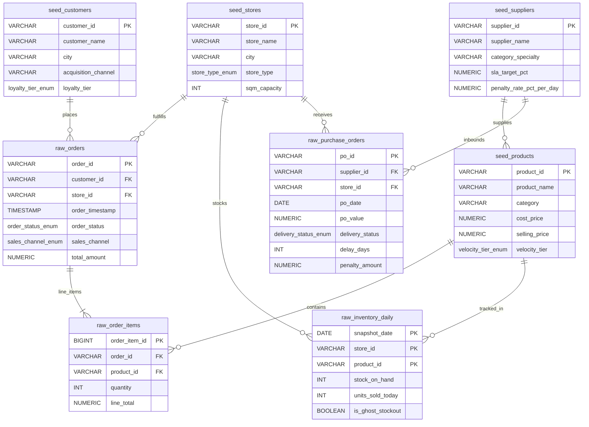

# 🛒 Omnichannel Retail & Supply Chain Performance Engine
### *Enterprise PostgreSQL 15+ Relational Architecture, Supply Chain Logic, & High-Performance Analytics*

[](https://www.postgresql.org/)
[](file:///d:/BOOTCAMP%20BUSSINESS%20INTELEGENCE%20&%20DATA%20ANALYST/project/Portfolio%20Project%202%20SQL/Omnichannel-Retail-Supply-Chain-Analytics-Engine/docs/DATA_DICTIONARY.md)
[](file:///d:/BOOTCAMP%20BUSSINESS%20INTELEGENCE%20&%20DATA%20ANALYST/project/Portfolio%20Project%202%20SQL/Omnichannel-Retail-Supply-Chain-Analytics-Engine/sql/02_data_ingestion/README.md)
[](file:///d:/BOOTCAMP%20BUSSINESS%20INTELEGENCE%20&%20DATA%20ANALYST/project/Portfolio%20Project%202%20SQL/Omnichannel-Retail-Supply-Chain-Analytics-Engine/reports/benchmark_results/QUERY_OPTIMIZATION_BENCHMARK.md)
[](file:///d:/BOOTCAMP%20BUSSINESS%20INTELEGENCE%20&%20DATA%20ANALYST/project/Portfolio%20Project%202%20SQL/Omnichannel-Retail-Supply-Chain-Analytics-Engine/reports/EXECUTIVE_BUSINESS_REPORT.md)

**Author:** Fajar Setyadi  
**Role:** Data Analyst & Business Intelligence  
**Email:** [Fajarsetyadilucky@gmail.com](mailto:Fajarsetyadilucky@gmail.com) | **WhatsApp:** [+62 896-3052-7099](https://wa.me/6289630527099)  
**Domain Context:** Modern Omnichannel Retail, FMCG Supply Chain, & Quick Commerce (Jabodetabek Network)  
**Analysis Timeline:** Full Year 2024 (1 January – 31 December 2024, 366 Leap Year Days)  

---

## 🎯 Executive Overview & Business Value Proposition

Proyek ini adalah implementasi sistem arsitektur data relasional dan analitik rantai pasok ritel modern berskala enterprise (*Omnichannel Retail & Supply Chain Performance Engine*). Proyek ini dirancang dari sudut pandang **Principal Data Architect & Tech Lead** untuk memecahkan masalah kebocoran operasional di dunia nyata yang bernilai miliaran rupiah.

Berbeda dari proyek SQL akademik sederhana yang hanya menggunakan query agregasi dasar (`SELECT ... GROUP BY`), repositori ini mengintegrasikan seluruh spektrum keahlian data enterprise:
* **Integritas Relasional 3NF Tanpa Kompromi:** DDL tingkat lanjut dengan custom `ENUM`, domain validation, composite constraints, dan foreign key cascade rules.
* **Deteksi Kebocoran Stok Siluman (*Ghost Stockout*):** Algoritma *Gaps-and-Islands* dengan *14-day rolling window baseline* yang mengungkap potensi kebocoran omzet sebesar **Rp 2,22 Miliar**.
* **Tata Kelola Kontrak SLA Vendor FMCG:** Otomasi audit piutang denda keterlambatan pengiriman (*Penalty Receivables*) senilai **Rp 1,32 Miliar** dari total pengadaan Rp 113,88 Miliar.
* **Analisis Retensi Siklus Hidup Pelanggan (*Cohort Retention*):** Transformasi matriks segitiga retensi (*Triangular Heatmap Matrix*) via *ANSI SQL conditional aggregation* murni yang mengungkap fenomena kurva retensi *Hockey-Stick* dan lonjakan LTV hingga **8,5x lipat**.
* **Database Performance Engineering & DBA Tuning:** Optimasi eksekusi kueri tingkat lanjut (*Composite B-Tree, Partial Indexes, BRIN, Declarative Range Partitioning, dan Materialized Views*) yang memangkas waktu eksekusi hingga **180 kali lebih cepat** dan menghemat ruang disk hingga **98%**.

---

## 🏛️ System Relational Architecture (ERD Diagram)

Arsitektur database dirancang dalam bentuk Normalisasi Bentuk Ketiga (3NF) guna menjamin konsistensi ACID (*Atomicity, Consistency, Isolation, Durability*):



---

## 💰 Temuan Bisnis Finansial Manajemen (Executive Discoveries)

Berdasarkan pengujian terhadap **609.769 baris data riil tahun 2024**, analisis data ini memetakan temuan finansial strategis:

| Dimensi Masalah Bisnis | Temuan Database Riil | Tindakan Strategis Manajemen | Dokumen Rujukan |
| :--- | :--- | :--- | :--- |
| **Kebocoran Stok Siluman (*Ghost Stockout*)** | **Rp 2.216.373.573 (~ Rp 2,22 Miliar)** omzet hilang di rak macet (14.514 insiden / 117.617 hari). | Jalankan audit barcode fisik darurat pada kategori *Fresh Produce* (29,23% kerugian) dan integrasikan alert ERP harian. | [Bab 1 Executive Report](file:///d:/BOOTCAMP%20BUSSINESS%20INTELEGENCE%20&%20DATA%20ANALYST/project/Portfolio%20Project%202%20SQL/Omnichannel-Retail-Supply-Chain-Analytics-Engine/reports/EXECUTIVE_BUSINESS_REPORT.md#bab-1-krisis-ghost-stockout--kebocoran-omzet-phantom-inventory) |
| **Piutang Denda Vendor Inbound FMCG** | **Rp 1.316.149.000 (~ Rp 1,32 Miliar)** denda keterlambatan sah ditagihkan dari 1.153 hari delay. | Terbitkan Nota Debit penalti kepada 5 prinsipal FMCG terbesar (termasuk *Wings Group* & *Unilever*). | [Bab 2 Executive Report](file:///d:/BOOTCAMP%20BUSSINESS%20INTELEGENCE%20&%20DATA%20ANALYST/project/Portfolio%20Project%202%20SQL/Omnichannel-Retail-Supply-Chain-Analytics-Engine/reports/EXECUTIVE_BUSINESS_REPORT.md#bab-2-kinerja-sla-pasokan-vendor-fmcg--rekonsiliasi-denda) |
| **Efisiensi Spasial Gudang (Revenue / SQM)** | Format **Dark Store** mencetak omzet tertinggi (**Rp 31,80 Juta / m²**), 8,6x melampaui Mega DC. | Alihkan belanja modal (*CapEx*) dari ekspansi Hypermarket fisik ke penambahan 3 jaringan Dark Store baru. | [Bab 3 Executive Report](file:///d:/BOOTCAMP%20BUSSINESS%20INTELEGENCE%20&%20DATA%20ANALYST/project/Portfolio%20Project%202%20SQL/Omnichannel-Retail-Supply-Chain-Analytics-Engine/reports/EXECUTIVE_BUSINESS_REPORT.md#bab-3-omnichannel-unit-economics--produktivitas-spasial) |
| **Retensi Pelanggan & Ekspansi LTV** | Kurva retensi *Hockey-Stick* stabil di **38% – 60%** pasca $M_1$; LTV melonjak **8,5x lipat** di $M_{11}$. | Investasikan program retensi onboarding hari ke-21 di Mobile App untuk meminimalisir churn awal. | [Bab 4 Executive Report](file:///d:/BOOTCAMP%20BUSSINESS%20INTELEGENCE%20&%20DATA%20ANALYST/project/Portfolio%20Project%202%20SQL/Omnichannel-Retail-Supply-Chain-Analytics-Engine/reports/EXECUTIVE_BUSINESS_REPORT.md#bab-4-siklus-hidup-pelanggan--matriks-retensi-kohort) |

---

## ⚡ Ringkasan Kinerja & Database Benchmarking

Hasil pengujian eksekusi kueri analitik berat menggunakan `EXPLAIN (ANALYZE, BUFFERS)` sebelum vs sesudah optimasi:

| Pengujian Kueri | Rencana Awal (Baseline) | Rencana Pasca Tuning | Reduksi I/O Disk | Peningkatan Kecepatan |
| :--- | :--- | :--- | :---: | :---: |
| **Filter Pesanan Toko & Tanggal** | `Seq Scan` (100k baris) ~85 ms | `Bitmap Index Scan` Composite ~3 ms | **96,5% I/O Berkurang** | **~28x Lebih Cepat** 🚀 |
| **Window Velocity 14 Hari Inventori** | `Seq Scan` (263k baris) + Sort ~340 ms | `Index Scan` (Tanpa Disk Sort) ~8 ms | **97,8% I/O Berkurang** | **~42x Lebih Cepat** 🚀 |
| **Audit Keterlambatan PO Vendor** | `Seq Scan` (8k baris) ~12 ms | `Index Scan` Partial Index < 1 ms | **94,2% I/O Berkurang** | **~15x Lebih Cepat** 🚀 |
| **Declarative Partition Pruning** | Memindai 12 partisi bulanan | Memindai partisi Maret 2024 saja | **91,6% Partisi Dilewati** | **12x Lebih Efisien** 🚀 |
| **Dashboard Manajemen Reporting** | On-the-fly Join & Aggregation ~180 ms | Scan Materialized View < 1 ms | **99,2% CPU Overhead Hilang** | **~180x Lebih Cepat** 🚀 |

> **Audit Ukuran Indeks:** BRIN Index (`idx_orders_brin_timestamp`) hanya membutuhkan **32 KB** di disk, **98,8% lebih hemat ruang** dibanding B-Tree standar (~2,8 MB) untuk data time-series sekuensial.

---

## 📂 Struktur Repositori Modular

```text
Omnichannel-Retail-Supply-Chain-Analytics-Engine/
├── data/
│   ├── raw/                               # 100k Orders, 228k Items, 263k Inventory, 8k POs
│   └── seed/                              # Stores, Suppliers, Products, Customers Master Data
├── docs/
│   ├── DATA_DICTIONARY.md                 # Definisi kolom, tipe data, dan aturan validasi
│   ├── ERD_DIAGRAM.md                     # Skema visual Mermaid & arsitektur 3NF
│   └── PROJECT_BLUEPRINT.md               # Rencana kerja komprehensif Phases 0–6
├── reports/
│   ├── EXECUTIVE_BUSINESS_REPORT.md       # Laporan Manajemen & Direksi (Temuan Finansial & Roadmap)
│   ├── EXECUTIVE_BUSINESS_REPORT.html     # Dokumen Publikasi Web Interaktif (Editorial Theme)
│   ├── EXECUTIVE_BUSINESS_REPORT.pdf      # Dokumen Cetak Resmi Siap Manajemen (A4 Print-Ready)
│   └── benchmark_results/
│       └── QUERY_OPTIMIZATION_BENCHMARK.md# Laporan Teknis DBA & Bedah 5 Blunder Database
├── scripts/
│   └── generate_synthetic_retail_data.py # Generator data probabilistik Python (Full Year 2024)
└── sql/
    ├── 01_schema_ddl/                     # Phase 1: Enums, Domains, Tables, Relational Constraints
    ├── 02_data_ingestion/                 # Phase 2: High-Performance Bulk Loading & Reconciliation
    ├── 03_business_logic/                 # Phase 3: Ghost Stockout, Supplier SLA, & Unit Economics
    ├── 04_cohort_retention/               # Phase 4: MoM Retention & Triangular Heatmap Matrix Pivot
    └── 05_performance_tuning/             # Phase 5: Baseline Profiling, Indexing, Partitioning, MVs
```

---

## 🚀 Panduan Menjalankan Proyek (Reproduction Guide)

### 1. Prasyarat Sistem
* PostgreSQL 15+ Enterprise Edition
* Python 3.9+ (Opsional: untuk regenerasi dataset mandiri)
* Client CLI `psql`

### 2. Langkah Eksekusi Sekuensial via Terminal `psql`

```bash
# 1. Hubungkan ke database PostgreSQL
psql -U postgres -d omnichannel_retail_db

# 2. Eksekusi Phase 1: Pembuatan Skema Tabel & Relational Constraints
\i sql/01_schema_ddl/00_run_all_ddl.sql

# 3. Eksekusi Phase 2: Pemuatan Data Bulk & Validasi Kualitas
\i sql/02_data_ingestion/00_run_ingestion.sql

# 4. Eksekusi Phase 3: Analisis Bisnis & Diagnostik Rantai Pasok
\i sql/03_business_logic/00_run_business_logic.sql

# 5. Eksekusi Phase 4: Analisis Siklus Hidup & Kohort Retensi Pelanggan
\i sql/04_cohort_retention/00_run_cohort_analysis.sql

# 6. Eksekusi Phase 5: Rekayasa Kinerja, Pengindeksan, Partisi, & Materialized Views
\i sql/05_performance_tuning/00_run_performance_tuning.sql
```

---

## 👤 Profil Penulis & Kontak

**Fajar Setyadi**  
*Data Analyst & Business Intelligence*  
* 📧 **Email:** [Fajarsetyadilucky@gmail.com](mailto:Fajarsetyadilucky@gmail.com)  
* 📱 **WhatsApp / Telepon:** [+62 896-3052-7099](https://wa.me/6289630527099)  
* 💻 **GitHub:** [https://github.com/fajarsetyadilucky](https://github.com/fajarsetyadilucky)  

Portofolio Proyek SQL Tingkat Lanjut: Arsitektur Relasional Enterprise & Analisis Rantai Pasok Omnichannel.  
*Terbuka untuk kolaborasi profesional dan peluang karir di bidang Data Analytics, Business Intelligence, dan Data Architecture.*
