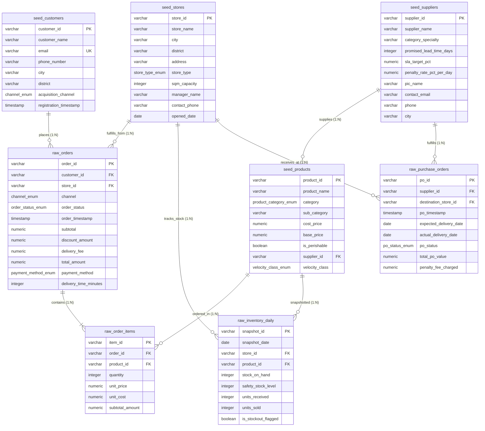

# 📐 Entity Relationship Diagram (ERD) & Relational Architecture
## Omnichannel Retail & Supply Chain Performance Engine

**Author:** Fajar Setyadi  
**Role:** Data Analyst & Business Intelligence  
**Environment:** PostgreSQL 15+ Enterprise Edition  
**Schema Normalization:** Strict Third Normal Form (3NF)  

---

## 🏛️ Skema Visual Mermaid ERD (8 Relational Tables)

---

## 🔗 Matriks Relasi Antar Tabel (Relational Integrity Matrix)

| Primary Table (1) | Foreign Key Table (N) | Foreign Key Column | Constraint & Cascade Rule | Deskripsi Relasi Bisnis |
| :--- | :--- | :--- | :--- | :--- |
| `seed_suppliers` | `seed_products` | `supplier_id` | `ON UPDATE CASCADE ON DELETE RESTRICT` | Satu vendor memasok banyak SKU produk. |
| `seed_suppliers` | `raw_purchase_orders` | `supplier_id` | `ON UPDATE CASCADE ON DELETE RESTRICT` | Satu vendor menerima banyak pesanan pengadaan B2B (PO). |
| `seed_stores` | `raw_orders` | `store_id` | `ON UPDATE CASCADE ON DELETE RESTRICT` | Satu toko/hub melayani banyak pesanan online dan offline. |
| `seed_stores` | `raw_inventory_daily` | `store_id` | `ON UPDATE CASCADE ON DELETE RESTRICT` | Satu toko memiliki log rekam stok harian per produk. |
| `seed_stores` | `raw_purchase_orders` | `destination_store_id` | `ON UPDATE CASCADE ON DELETE RESTRICT` | Satu toko menjadi tujuan pengantaran barang dari vendor. |
| `seed_customers` | `raw_orders` | `customer_id` | `ON UPDATE CASCADE ON DELETE RESTRICT` | Satu pelanggan dapat bertransaksi berulang kali (*Repeat Orders*). |
| `raw_orders` | `raw_order_items` | `order_id` | `ON UPDATE CASCADE ON DELETE CASCADE` | Satu nota pesanan berisi 1 atau lebih varian item barang (*Cart Line Items*). |
| `seed_products` | `raw_order_items` | `product_id` | `ON UPDATE CASCADE ON DELETE RESTRICT` | Satu produk dapat dibeli di banyak transaksi berbeda. |
| `seed_products` | `raw_inventory_daily` | `product_id` | `ON UPDATE CASCADE ON DELETE RESTRICT` | Satu produk dicatat posisi stoknya setiap hari di setiap toko. |

---

## 🛡️ Aturan Integritas Relasional & Constraints
* **Natural/Business Primary Keys:** Semua tabel menggunakan ID terstruktur yang bermakna (`STR-xxx`, `SUP-xxx`, `PRD-xxx`, `CUST-xxx`, `ORD-xxx`, `ITM-xxx`, `INV-xxx`, `PO-xxx`).
* **Foreign Key Constraints:** Menjamin *Zero Orphan Records* pada seluruh 609.769 baris data.
* **Positive Financial Constraints:** Validasi `CHECK (cost_price > 0)`, `CHECK (quantity > 0)`, dan `CHECK (total_amount >= 0)` untuk menjamin realisme finansial.
