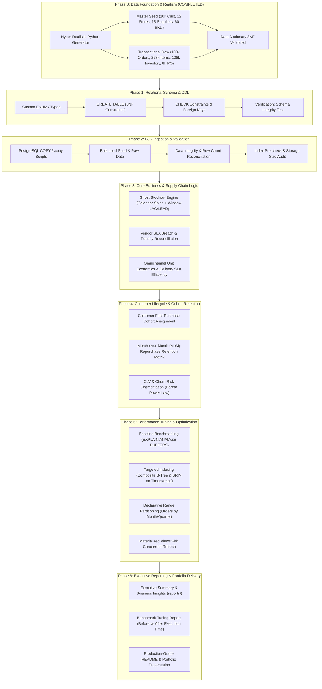

# 🗺️ Master Blueprint & Alur Pengerjaan End-to-End
## Omnichannel Retail & Supply Chain Performance Engine (PostgreSQL Enterprise)

**Author:** Fajar Setyadi  
**Role:** Data Analyst & Business Intelligence  
**Target Environment:** PostgreSQL 15+ / Enterprise  
**Versi Blueprint:** 1.0 (Production Roadmap)

---

## 🧭 Ikhtisar Filosofi Proyek
Proyek ini dirancang bukan sekadar untuk menjalankan query SQL dasar (`SELECT`, `WHERE`, `GROUP BY`), melainkan untuk mendemonstrasikan kapabilitas **Senior / Enterprise Data Analyst** dalam:
1. **Relational Data Architecture (3NF & Data Integrity)**.
2. **Deep Business Problem Solving** (Kebocoran modal vendor, *Ghost Stockout*, dan *Cohort Repurchase Retention*).
3. **Database Performance Engineering** (`EXPLAIN ANALYZE`, Composite Indexes, BRIN, Table Partitioning, dan Query Optimization).
4. **Executive Business Communication** (Rekomendasi bisnis yang dapat ditindaklanjuti untuk C-Level / VP Retail).

---

## 📊 Matriks Alur Pengerjaan (Phase 0 s/d Phase 6)

---

## 🛠️ Rincian Detail Setiap Fase

### 🟢 Phase 0: Data Foundation & Hyper-Realism (Status: ✅ 100% Selesai)
* **Objektif:** Menyediakan dataset berskala enterprise yang 100% realistis, bebas dari pola bot, dan mencerminkan lanskap ritel Jabodetabek.
* **Deliverables:**
  - `scripts/generate_synthetic_retail_data.py` (Generator < 26 detik).
  - 4 Master Seed CSVs (`data/seed/`).
  - 4 Transactional Raw CSVs (`data/raw/`).
  - `docs/DATA_DICTIONARY.md`.

---

### 🟡 Phase 1: Relational Architecture & DDL (`sql/01_schema_ddl/`)
* **Objektif:** Membangun skema database relasional 3NF yang tangguh di PostgreSQL dengan *data integrity guards*.
* **Langkah Kerja:**
  1. **File `01_create_enums_and_domains.sql`:**
     - Tipe ENUM kustom: `order_status_enum` (`COMPLETED`, `CANCELLED`, `RETURNED`), `sales_channel_enum`, `delivery_status_enum`, `loyalty_tier_enum`.
  2. **File `02_create_tables.sql`:**
     - Skema tabel master: `stores`, `suppliers`, `products`, `customers`.
     - Skema tabel transaksional: `orders`, `order_items`, `inventory_daily`, `purchase_orders`.
  3. **File `03_add_constraints.sql`:**
     - `PRIMARY KEY` dan `FOREIGN KEY` dengan `ON DELETE RESTRICT`.
     - `CHECK` constraints:
       - `selling_price >= cost_price`
       - `sla_target_pct BETWEEN 0 AND 100`
       - `stock_available = stock_on_hand - stock_reserved`
       - `total_amount = subtotal + shipping_fee - discount_amount`

---

### 🟡 Phase 2: Ingestion & Bulk Data Loading (`sql/02_data_ingestion/`)
* **Objektif:** Memuat ratusan ribu baris data CSV ke PostgreSQL secara efisien dan tervalidasi.
* **Langkah Kerja:**
  1. **File `01_copy_from_csv.sql`:**
     - Perintah `\copy` psql / `COPY` server dengan format CSV Header.
     - Penataan urutan pemuatan (Master Seed terlebih dahulu sebelum Transaksional guna mematuhi Foreign Key constraints).
  2. **File `02_validate_ingestion.sql`:**
     - Rekonsiliasi jumlah baris (*row count matching*) antara CSV dan database.
     - Validasi nullability dan relasi orphan check (`LEFT JOIN WHERE IS NULL`).

---

### 🟡 Phase 3: Core Business & Supply Chain Analytics (`sql/03_business_logic/`)
* **Objektif:** Menjawab masalah bisnis krusial yang bernilai jutaan rupiah bagi manajemen ritel.
* **Langkah Kerja:**
  1. **File `01_ghost_stockout_detection.sql` (Kasus Kebocoran Stok):**
     - **Teknik:** `GENERATE_SERIES` (Calendar Spine) digabung dengan `WINDOW FUNCTION` (`LAG`, `LEAD`, `AVG`).
     - **Logika:** Produk kategori `FAST` moving dengan `stock_on_hand > 50` tetapi `units_sold = 0` selama $\ge 3$ hari berturut-turut.
     - **Output Finansial:** Estimasi *Lost Sales Opportunity* (Rupiah yang hilang per toko per hari).
  2. **File `02_supplier_sla_and_penalty.sql` (Kasus Efisiensi Vendor):**
     - **Teknik:** Analisis keterlambatan (`actual_delivery_date - expected_delivery_date`).
     - **Logika:** Kalkulasi denda penalti harian (`po_value * penalty_rate * delay_days`) dan realisasi SLA vs target kontrak.
     - **Output Finansial:** Rekap piutang denda penalti yang harus ditagihkan ke vendor bermasalah.
  3. **File `03_omnichannel_unit_economics.sql` (Kasus Profitabilitas Kanal):**
     - **Teknik:** Agregasi multi-dimensi per toko dan per kanal penjualan.
     - **Logika:** Net Margin = `(Selling Price - Cost Price) - Discount - Shipping Subsidy`.
     - **Output Finansial:** Identifikasi kanal yang membakar modal (*loss leader*) vs kanal penghasil margin bersih tertinggi.

---

### 🟡 Phase 4: Customer Lifecycle & Cohort Retention (`sql/04_cohort_retention/`)
* **Objektif:** Menganalisis retensi pelanggan menggunakan SQL murni tingkat lanjut tanpa bantuan Python/Excel.
* **Langkah Kerja:**
  1. **File `01_cohort_first_purchase.sql`:**
     - Penentuan bulan pertama belanja (*Cohort Month*) tiap pelanggan via `DATE_TRUNC('month', MIN(order_timestamp))`.
  2. **File `02_mom_retention_matrix.sql`:**
     - Perhitungan indeks bulan ke-N ($M_0, M_1, M_2, \dots, M_{11}$).
     - Repurchase Retention Rate (% pelanggan aktif kembali tiap bulan).
  3. **File `03_cohort_crosstab_pivot.sql`:**
     - Mentransformasi data vertikal menjadi tabel matriks segitiga retensi (*Triangular Heatmap Matrix*) langsung via query SQL.

---

### 🟡 Phase 5: Query Performance Engineering & Benchmarking (`sql/05_performance_tuning/`)
* **Objektif:** Menunjukkan keahlian *Database Administrator / Performance Tuning* dalam mengoptimasi query skala besar.
* **Langkah Kerja:**
  1. **File `01_slow_query_baseline.sql`:**
     - Eksekusi query analitik kompleks tanpa indeks.
     - Pengambilan log `EXPLAIN (ANALYZE, BUFFERS, COSTS)` (mencatat Seq Scan, buffer hits, execution time).
  2. **File `02_indexing_strategy.sql`:**
     - Implementasi **Composite B-Tree Indexes** pada filter berulang (`store_id, order_timestamp`).
     - Implementasi **BRIN (Block Range Index)** pada tabel time-series raksasa (`orders` dan `inventory_daily`) untuk menghemat disk space 90% dibanding B-Tree.
  3. **File `03_table_partitioning.sql`:**
     - Partisi deklaratif tabel `orders` berdasarkan rentang waktu (`PARTITION BY RANGE (order_timestamp)`).
     - Pembuktian *Partition Pruning* via EXPLAIN ANALYZE.
  4. **File `04_materialized_views.sql`:**
     - Pembuatan Materialized View untuk query agregasi berat harian dengan indexing khusus dan `REFRESH MATERIALIZED VIEW CONCURRENTLY`.

---

### 🟡 Phase 6: Executive Reporting, Deliverables, & Showcase (`reports/` & `README.md`)
* **Objektif:** Mengemas hasil analisis ke dalam laporan eksekutif berstandar industri dan etalase portofolio profesional.
* **Langkah Kerja:**
  1. **File `reports/EXECUTIVE_BUSINESS_REPORT.md`:**
     - Ringkasan temuan bagi Direksi: Berapa miliar rupiah potensi penjualan yang hilang akibat *Ghost Stockout*? Vendor mana yang paling merugikan? Kanal mana yang paling profitabel?
  2. **File `reports/benchmark_results/QUERY_OPTIMIZATION_BENCHMARK.md`:**
     - Tabel komparasi performa sebelum vs sesudah tuning (Execution time: misal ~1,250 ms $\rightarrow$ ~12 ms, Cost reduction, Buffer I/O reduction).
  3. **Pembaruan Final [README.md](file:///d:/BOOTCAMP%20BUSSINESS%20INTELEGENCE%20&%20DATA%20ANALYST/project/Portfolio%20Project%202%20SQL/Omnichannel-Retail-Supply-Chain-Analytics-Engine/README.md):**
     - Tampilan visual, diagram alur, snippet kueri unggulan, dan panduan menjalankan bagi recruiter atau hiring manager.

---

## 🎯 Status Kesiapan
| No | Komponen Blueprint | Status | Catatan |
| :--- | :--- | :---: | :--- |
| **0** | Data Foundation & Generator (609k+ baris) | ✅ **SELESAI** | 100% Hyper-realistic & tersinkronisasi 366 hari |
| **1** | DDL Skema Relasional 3NF & Constraints | ✅ **SELESAI** | Folder `sql/01_schema_ddl/` |
| **2** | Script Bulk Ingestion & Reconcile | ✅ **SELESAI** | Folder `sql/02_data_ingestion/` |
| **3** | Logika Bisnis & Diagnostic SQL | ✅ **SELESAI** | Folder `sql/03_business_logic/` |
| **4** | Cohort Repurchase Matrix SQL | ✅ **SELESAI** | Folder `sql/04_cohort_retention/` |
| **5** | Performance Tuning (BRIN, Partition, Explain) | ✅ **SELESAI** | Folder `sql/05_performance_tuning/` |
| **6** | Executive Business Report & Benchmarks | ✅ **SELESAI** | Folder `reports/` & root `README.md` |
