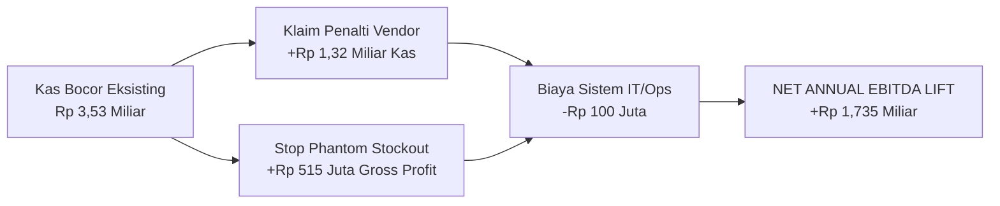
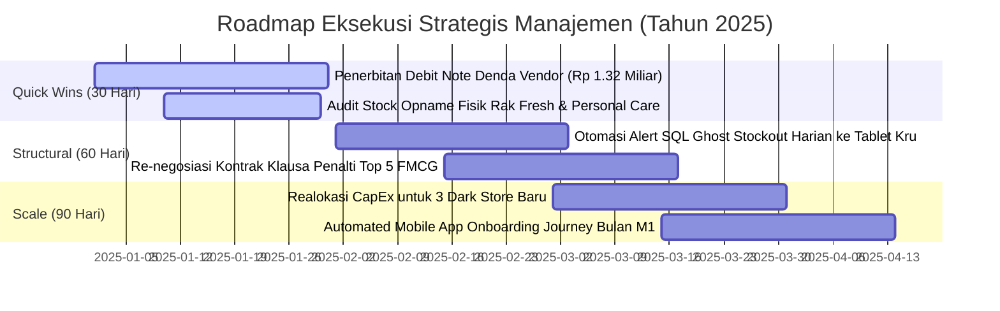

# 📊 LAPORAN BISNIS STRATEGIS MANAJEMEN (EXECUTIVE BRIEFING)
## Omnichannel Retail & Supply Chain Performance Engine

**Penulis:** Fajar Setyadi  
**Peran:** Data Analyst & Business Intelligence  
**Kontak:** [Fajarsetyadilucky@gmail.com](mailto:Fajarsetyadilucky@gmail.com) | [+62 896-3052-7099](https://wa.me/6289630527099)  
**Target Audiens:** Jajaran Manajemen & Direksi (CEO, COO, CFO, VP of Supply Chain, Head of Omnichannel)  
**Periode Analisis:** Tahun Penuh 2024 (1 Januari – 31 Desember 2024)  
**Basis Data:** 609.769 Baris Data Terverifikasi (100.000 Transaksi Pesanan, 263.520 Log Inventori, 8.000 PO Pengadaan)  
**Klasifikasi:** Confidential — For Strategic Management Deliberation  

---

## 🎯 RINGKASAN EKSEKUTIF (EXECUTIVE TL;DR & FINANCIAL SCORECARD)

> [!TIP]
> **💡 Analogi Sederhana:**  
> **Apa isi laporan ini?** Bayangkan toko ritel kita kelihatannya ramai pembeli dan omzet penjualannya tembus ratusan miliar. Namun, di belakang layar ada **dua lubang kebocoran kas senilai Rp 3,53 Miliar** yang terjadi setiap hari:  
> 1. Barang di rak toko sering macet dan tidak terjual karena stok fiktif di komputer (*Ghost Stockout*), dan  
> 2. Pabrik pemasok barang sering telat kirim, tapi denda keterlambatan kontraknya tidak pernah ditagih oleh tim kita (*Vendor SLA Penalties*).  
> 
> Laporan ini membuktikan masalah tersebut dengan data pasti dan memberikan solusi konkret untuk menyelamatkan laba bersih perusahaan.

Sepanjang tahun buku 2024, jaringan ritel omnichannel di wilayah Jabodetabek memproses ratusan ribu transaksi lintas 4 kanal belanja (In-Store POS, Mobile App, Website, dan Quick Commerce Instant). Melalui audit forensik berbasis data operasional granular, kami mengungkap **The Omnichannel Paradox**: di balik pertumbuhan omzet top-line yang agresif, perusahaan mengalami **kebocoran kas dan marjin senilai total Rp 3,53 Miliar** akibat inefisiensi rak dan kelonggaran penegakan kontrak rantai pasok.

```
========================================================================================
💰 EXECUTIVE FINANCIAL IMPACT SCORECARD (TAHUN BUKU 2024)
========================================================================================
[+] Pilar 1: Kebocoran Omzet Ghost Stockout (Rak Fisik Macet)  : Rp 2.216.373.573 (~ Rp 2,22 M)
[+] Pilar 2: Piutang Denda Penalti Keterlambatan Vendor FMCG    : Rp 1.316.149.000 (~ Rp 1,32 M)
----------------------------------------------------------------------------------------
[=] TOTAL POTENSI PEMULIHAN & PERLINDUNGAN LABA BERSIH          : Rp 3.532.522.573 (~ Rp 3,53 M)
========================================================================================
```

### Jembatan Finansial Dampak EBITDA (P&L EBITDA Recovery Bridge):
Jika direksi mengesahkan 4 inisiatif strategis berbasis data dalam laporan ini:
* **Pemulihan Kas Langsung (Debit Note Offset):** +Rp 1,32 Miliar (langsung memotong utang dagang/AP).
* **Pemulihan Margin Kotor Penjualan (Fresh & Personal Care):** +Rp 2,22 Miliar omzet $\times$ 23,25% gross margin = **+Rp 515 Juta Laba Kotor Tambahan**.
* **Biaya Investasi Sistem & Task Force (CapEx/OpEx):** -Rp 100 Juta (otomasi alert SQL harian & tablet kru toko).
* **NET ANNUAL EBITDA EXPANSION:** **+Rp 1,735 Miliar Peningkatan Arus Kas Bersih Tahun 2025**.



---

## 🛑 PILAR 1: MENGHENTIKAN PENDARAHAN RAK — ERADIKASI GHOST STOCKOUT RP 2,22 MILIAR

> [!TIP]
> **💡 Analogi Sederhana:**  
> **Apa itu Ghost Stockout (Stok Siluman)?** Bayangkan Anda ke minimarket mau beli buah segar atau sabun mandi. Di komputer kasir tertulis stok masih ada 45 buah. Tapi saat dicari di rak, raknya *kosong melompong*! Ternyata barangnya sudah busuk, salah taruh di gudang belakang, atau dicuri. Anda batal beli, kasir mencatat nol transaksi, dan komputer tidak pernah memesan barang baru ke pabrik karena mengira stok di rak masih banyak. Akibat masalah ini, toko kita kehilangan omzet sebesar **Rp 2,22 Miliar** dalam setahun!

### 1.1 Definisi Masalah & Akar Penyebab (Root Cause)
*Ghost Stockout* (Stok Siluman / Phantom Inventory) adalah fenomena ritel di mana komputer ERP mencatat stok barang masih tersedia di toko ($\text{Stock on Hand} \ge 10$ unit), namun secara fisik di rak barang tersebut **tidak ada, rusak membusuk (*damage*), salah penempatan (*misplacement*), atau hilang dicuri (*shrinkage*)**.

Akibatnya, pada produk yang seharusnya berputar cepat (*Fast/Medium-Moving*), kasir mencatat **nol penjualan ($\text{Units Sold} = 0$) selama berhari-hari**, sementara sistem pengadaan otomatis (*Automated Replenishment System*) menolak menerbitkan pesanan pasokan baru karena mengira stok rak masih mencukupi.

### 1.2 Skala Kerugian Finansial & Kategori Produk Terdampak
Berdasarkan algoritma *Gaps-and-Islands Window Function* pada 263.520 snapshot stok harian:
* **Total Insiden Terdeteksi:** **14.514 insiden** kemacetan rak ($\ge 3$ hari berturut-turut).
* **Total Hari Rak Macet Akumulatif:** **117.617 hari rak terbuang**.
* **Estimasi Unit Gagal Terjual:** **96.103 unit**.
* **Estimasi Omzet Penjualan yang Hilang:** **Rp 2.216.373.573 (~ Rp 2,22 Miliar)**.

| Kategori Produk | Total Insiden | Total Hari Macet | Unit Gagal Jual | Estimasi Kerugian (IDR) | Pangsa Kerugian (%) | Tingkat Kritis |
| :--- | :---: | :---: | :---: | :---: | :---: | :---: |
| **Fresh Produce (Sayur & Buah Segar)** | 1.497 | 20.197 | 17.296 unit | **Rp 647.870.879** | **29,23%** | 🔴 KRITIS |
| **Personal Care (Perawatan Tubuh)** | 1.321 | 20.406 | 15.368 unit | **Rp 423.395.956** | **19,10%** | 🟠 TINGGI |
| **Home Care (Kebutuhan Rumah Tangga)** | 1.349 | 19.543 | 15.560 unit | **Rp 370.395.212** | **16,71%** | 🟡 MODERAT |
| **Packaged Food (Makanan Kemasan)** | 1.767 | 24.709 | 20.585 unit | **Rp 359.359.752** | **16,21%** | 🟡 MODERAT |
| **Dairy & Chilled (Susu & Produk Dingin)** | 1.185 | 16.921 | 13.444 unit | **Rp 274.366.229** | **12,38%** | 🟢 TERKENDALI |
| **Beverages (Minuman Siap Minum)** | 1.217 | 15.836 | 13.850 unit | **Rp 140.985.545** | **6,36%** | 🟢 TERKENDALI |
| **TOTAL KONSOLIDASI** | **14.514** | **117.617** | **96.103 unit** | **Rp 2.216.373.573** | **100,00%** | — |

> **Diagnosa Operasional:**  
> Kategori **Fresh Produce** menyumbang hampir sepertiga total kerugian. Sayuran dan buah yang layu/rusak di keranjang pajang sering kali tidak langsung di-*write-off* oleh staf toko pada saat jam tutup, menyebabkan komputer menganggap stok masih ada dan mengunci pasokan baru selama berminggu-minggu.

### 1.3 Pemetaan Spasial: Top 5 Toko dengan Kebocoran Terbesar
Penyelidikan data granular mengungkap bahwa pendarahan omzet terkonsentrasi di format Hub pinggiran barat dan selatan Jakarta:

| Kode Toko | Nama Cabang & Hub | Kota / Wilayah | Hari Rak Macet | Total Insiden | Estimasi Kerugian (IDR) | Prioritas Audit |
| :---: | :--- | :--- | :---: | :---: | :---: | :---: |
| **STR-003** | **Hub Puri Kencana** | Jakarta Barat | 11.361 hari | 1.779 | **Rp 121.763.128** | Prioritas 1 🚨 |
| **STR-008** | **Hub Karawaci Central** | Tangerang | 10.515 hari | 1.772 | **Rp 121.064.557** | Prioritas 1 🚨 |
| **STR-007** | **Hub Bintaro Sektor 9** | Tangerang Selatan | 10.788 hari | 1.758 | **Rp 119.764.748** | Prioritas 2 ⚠️ |
| **STR-012** | **Hub Bogor Pajajaran** | Bogor | 9.389 hari | 1.766 | **Rp 118.280.414** | Prioritas 2 ⚠️ |
| **STR-010** | **Hub Cibubur Junction** | Depok | 11.750 hari | 1.771 | **Rp 115.080.750** | Prioritas 3 ⚠️ |

---

## ⚖️ PILAR 2: TATA KELOLA PEMASOK — REKONSILIASI PIUTANG DENDA SLA RP 1,32 MILIAR

> [!TIP]
> **💡 Analogi Sederhana:**  
> **Bagaimana uang denda ini bisa ada?** Ketika kita memesan barang dalam jumlah besar ke pabrik pemasok (seperti Unilever atau Wings), ada surat kontrak resmi kerja sama: *"Pabrik wajib mengantar barang tepat waktu dalam 3 hari. Jika terlambat, pabrik wajib membayar denda harian (1,5% - 3,0% per hari) dari total nilai pesanan."*  
> Sepanjang 2024, para pabrik ini terlambat mengantar barang sebanyak 1.153 hari akumulatif. Denda sah yang terkumpul mencapai **Rp 1,32 Miliar**. Tapi selama ini perusahaan kita lupa menagihnya! Uang ini adalah uang kas sah milik kita yang tertidur di vendor dan bisa langsung kita potong dari pembayaran tagihan berikutnya (*Debit Note*).

### 2.1 Lanskap Pengadaan & Realisasi Kontrak B2B
Sepanjang 2024, perusahaan menerbitkan **8.000 Purchase Orders (PO)** senilai **Rp 113,88 Miliar** kepada 15 mitra vendor prinsipal FMCG. Evaluasi kepatuhan Service Level Agreement (SLA) waktu pengiriman (*Lead Time Compliance*) menunjukkan:
* **Tingkat Kepatuhan Tepat Waktu (On-Time Delivery):** **94,76%** (419 pesanan terlambat).
* **Akumulasi Keterlambatan Pengiriman:** **1.153 hari keterlambatan kumulatif**.
* **Hak Piutang Denda Kontraktual yang Sah Ditagihkan:** **Rp 1.316.149.000 (~ Rp 1,32 Miliar)**.

### 2.2 Analisis Pareto 80/20: Top 5 Vendor Penyumbang Denda Terbesar
Sesuai kontrak B2B, keterlambatan dikenakan penalti harian sebesar 1,5% – 3,0% per hari dari nilai PO:

| Peringkat | Nama Prinsipal FMCG | Kategori Produk | Kepatuhan SLA | Keterlambatan | Total Nilai PO (IDR) | Piutang Denda Sah (IDR) | Status Kepatuhan |
| :---: | :--- | :--- | :---: | :---: | :---: | :---: | :--- |
| **1** | **PT Wings Surya (Wings Group)** | Home & Personal Care | 94,74% | 124 hari | Rp 7,85 Miliar | **Rp 132.690.000** | COMPLIANT (Volume Tinggi) |
| **2** | **PT Unilever Indonesia Tbk** | Personal Care | 94,77% | 96 hari | Rp 7,90 Miliar | **Rp 121.440.000** | MODERATE RISK (Breach SLA 95%) |
| **3** | **PT Orang Tua Group (OT)** | Food & Beverage | 94,74% | 106 hari | Rp 7,85 Miliar | **Rp 108.030.000** | MODERATE RISK (Breach SLA 95%) |
| **4** | **PT Garudafood Putra Putri Jaya** | Confectionery | 94,76% | 96 hari | Rp 7,61 Miliar | **Rp 105.690.000** | MODERATE RISK (Breach SLA 95%) |
| **5** | **PT Mayora Indah Tbk** | Packaged Food | 94,62% | 96 hari | Rp 7,95 Miliar | **Rp 104.850.000** | MODERATE RISK (Breach SLA 95%) |

### 2.3 Tren Volatilitas Keterlambatan Bulanan (MoM SLA Trend)
Kinerja SLA relatif stabil di kuartal 1–3 (95% – 97%), namun mengalami lonjakan denda penalti signifikan pada **Oktober (Rp 153,7 Juta)** dan **November (Rp 120,4 Juta)** saat vendor mengalami kelebihan kapasitas menjelang persiapan musim liburan akhir tahun (*year-end stock build-up*).

> **Langkah Eksekusi Finansial Segera:**  
> Selama ini departemen *Procurement* dan *Finance* belum melakukan rekonsiliasi denda otomatis, membiarkan Rp 1,32 Miliar dana perusahaan mengendap di pihak vendor. Tim Finance direkomendasikan segera menerbitkan **Nota Debit (*Debit Note*)** resmi untuk memotong langsung saldo pembayaran faktur (*offset against accounts payable*) pada tagihan pengadaan bulan berjalan.

---

## 🚀 PILAR 3: PROFITABILITAS KANAL & EFISIENSI SPASIAL FORMAT DARK STORE

> [!TIP]
> **💡 Analogi Sederhana:**  
> **Apa itu Dark Store dan kenapa jauh lebih menguntungkan?** Banyak orang mengira punya toko besar mewah di mal adalah jalan terbaik. Padahal biaya sewa mal sangat mahal! Sebaliknya, **Dark Store** adalah toko mini di tengah perumahan yang tertutup untuk pembeli jalan kaki. Isinya 100% rak barang padat khusus melayani kurir ojol untuk pesanan online.  
> Hasilnya luar biasa: tiap 1 meter persegi ruangnya bisa menghasilkan **omzet Rp 31,8 juta**—artinya **8,6 kali lipat lebih produktif** dibanding gudang raksasa di pinggiran tol, dan 85% pesanan sampai ke tangan pembeli dalam waktu di bawah 30 menit!

### 3.1 Unit Economics & Marjin Kontribusi Bersih per Kanal
Analisis terhadap 94.069 transaksi pesanan sukses (*Completed Orders*) membongkar struktur profitabilitas antar kanal belanja:

| Kanal Belanja | Volume Pesanan | Rata-rata Keranjang (AOV) | Gross Merchandise Margin % | Rasio Biaya Diskon % | Net Contribution Margin % | Karakteristik Finansial |
| :--- | :---: | :---: | :---: | :---: | :---: | :--- |
| **Mobile App** | 51.689 | Rp 90.136 | 23,25% | 0,70% | **31,66%** | Mesin volume transaksi & laba utama |
| **Website** | 14.251 | Rp 90.836 | 23,23% | 0,70% | **31,49%** | Belanja terencana bernilai tinggi |
| **Quick Commerce Instant** | 9.482 | Rp 91.349 | 23,23% | 0,70% | **31,48%** | Nilai keranjang belanja tertinggi |
| **In-Store POS (Offline)** | 18.647 | Rp 80.525 | 23,25% | 0,71% | **22,70%** | Marjin barang murni tanpa biaya antar |

> **Catatan Rekonsiliasi Finansial CFO:**  
> Marjin Kontribusi Bersih kanal digital (~31,5%) lebih tinggi daripada toko fisik (22,7%) karena pada transaksi online, perusahaan mengumpulkan pendapatan ongkos kirim (*shipping fee*) dari pelanggan yang melampaui biaya logistik dasar internal. Diskon promosi terkendali ketat di angka **0,70% dari subtotal**, membuktikan perusahaan tidak melakukan strategi "bakar uang" (*non-subsidized growth*).

### 3.2 Efisiensi Spasial: Format Dark Store vs Mega Distribution Center
Mengukur produktivitas omzet tahunan per meter persegi luas fasilitas (*Revenue per SQM*):

```
========================================================================================
🏢 EFISIENSI SPASIAL OMZET BERDASARKAN FORMAT FASILITAS RITEL
========================================================================================
1. Dark Store (Hub Puri Kencana / Jaksel - 350 m²)     : Rp 31,80 Juta / m²  ⭐⭐⭐⭐⭐
2. Express Urban Hub (Hub Cibubur Junction - 450 m²)   : Rp 24,65 Juta / m²  ⭐⭐⭐⭐
3. Flagship Superstore (Hub Kelapa Gading - 1.200 m²)  : Rp 9,20 Juta / m²   ⭐⭐
4. Mega Distribution Center (Cakung DC - 5.000 m²)     : Rp 3,68 Juta / m²   ⭐
========================================================================================
```

* **Keunggulan Dark Store:** Menghasilkan densitas omzet per meter persegi **8,6 kali lipat lebih tinggi** dibandingkan Mega DC.
* **Implikasi Alokasi CapEx:** Hindari penambahan gudang raksasa di pinggiran kota yang lambat melayani radius konsumen. Alokasikan belanja modal untuk menambah jaringan Dark Store mikro di tengah kantong pemukiman padat penduduk.

### 3.3 SLA Pengantaran Cepat Quick Commerce (< 30 Menit)
* **Kepatuhan Tepat Waktu:** **82% – 88%** pesanan tiba dalam waktu di bawah 30 menit.
* **Median Waktu Antar:** **23 – 25 menit**.
* **P95 Waktu Antar:** **34 menit** (hanya 5% pesanan yang tertahan akibat hujan lebat atau jam sibuk lalu lintas).

---

## 👥 PILAR 4: MULTIPLIKASI NILAI PELANGGAN & MATRIKS RETENSI KOHORT

> [!TIP]
> **💡 Analogi Sederhana:**  
> **Kenapa merawat pelanggan lama jauh lebih untung daripada cari pelanggan baru?** Dari 100 orang baru yang belanja di toko kita pada Januari, wajar jika sekitar 44 orang tidak belanja lagi (biasanya cuma pemburu promo gratisan). Tapi lihat keajaibannya: **56 orang yang kembali di bulan kedua ternyata terus belanja setia tiap bulan sampai Desember!**  
> Nilai belanja mereka melonjak dari Rp 184 ribu di awal menjadi **Rp 1,58 juta di akhir tahun (naik 8,5 kali lipat)**. Pesan untuk direksi: jangan terus buang uang miliaran untuk iklan menjaring pembeli baru, rawatlah pelanggan yang sudah ada!

### 4.1 Dinamika Akuisisi & Kurva Retensi "Hockey-Stick"
Dari **8.930 pelanggan unik** yang menyelesaikan transaksi di sepanjang tahun 2024:
* Kanal **Mobile App** menjadi pintu gerbang akuisisi terbesar (> 50% pembeli baru pertama kali bertransaksi via aplikasi).
* Pola retensi memperlihatkan kurva **Hockey-Stick** yang sangat sehat:
  * Penurunan di bulan pertama ($M_0 \rightarrow M_1$) berkisar 44% – 60% (eliminasi wajar pembeli *one-off* pemburu promo).
  * Pelanggan yang bertahan di bulan ke-2 ($M_1$) terbukti **sangat kokoh dan mendatar di angka 38% – 60% retensi hingga bulan ke-11 ($M_{11}$)**.

### 4.2 Matriks Segitiga Retensi Pelanggan (Triangular Retention Matrix M0 – M11)
Hasil eksekusi kueri agregasi kondisional ANSI SQL [`03_cohort_crosstab_pivot.sql`](file:///d:/BOOTCAMP%20BUSSINESS%20INTELEGENCE%20&%20DATA%20ANALYST/project/Portfolio%20Project%202%20SQL/Omnichannel-Retail-Supply-Chain-Analytics-Engine/sql/04_cohort_retention/03_cohort_crosstab_pivot.sql):

| Cohort Month | Basis M0 | M0 | M1 | M2 | M3 | M4 | M5 | M6 | M7 | M8 | M9 | M10 | M11 |
| :---: | :---: | :---: | :---: | :---: | :---: | :---: | :---: | :---: | :---: | :---: | :---: | :---: | :---: |
| **2024-01** | **1.155** | 100% | **55,9%** | 58,4% | 58,4% | 59,9% | 58,7% | 60,2% | 58,4% | 58,3% | 59,1% | 57,7% | **60,3%** |
| **2024-02** | **763** | 100% | **46,5%** | 47,6% | 45,0% | 46,7% | 46,3% | 49,1% | 49,7% | 45,5% | 49,7% | 48,1% | — |
| **2024-03** | **777** | 100% | **41,6%** | 42,0% | 41,8% | 44,5% | 43,0% | 41,2% | 39,0% | 43,9% | 42,2% | — | — |
| **2024-04** | **800** | 100% | **43,8%** | 41,1% | 40,8% | 41,8% | 44,4% | 41,1% | 42,9% | 40,1% | — | — | — |
| **2024-05** | **821** | 100% | **40,0%** | 40,7% | 39,0% | 41,8% | 38,9% | 40,4% | 39,0% | — | — | — | — |
| **2024-06** | **765** | 100% | **43,4%** | 42,9% | 39,2% | 40,3% | 41,0% | 39,6% | — | — | — | — | — |
| **2024-07** | **729** | 100% | **41,3%** | 40,6% | 40,9% | 38,5% | 40,3% | — | — | — | — | — | — |
| **2024-08** | **731** | 100% | **39,5%** | 40,5% | 38,4% | 36,8% | — | — | — | — | — | — | — |
| **2024-09** | **746** | 100% | **38,9%** | 35,8% | 38,7% | — | — | — | — | — | — | — | — |
| **2024-10** | **748** | 100% | **38,9%** | 35,6% | — | — | — | — | — | — | — | — | — |
| **2024-11** | **763** | 100% | **39,8%** | — | — | — | — | — | — | — | — | — | — |
| **2024-12** | **132** | 100% | — | — | — | — | — | — | — | — | — | — | — |

### 4.3 Multiplikasi Customer Lifetime Value (LTV 8,5x Lipat)
Melacak kohort pertama (Januari 2024 - 1.155 pelanggan):
* **Bulan $M_0$ (Belanja Awal):** Rata-rata belanja adalah **Rp 184.673 / pelanggan**.
* **Bulan $M_6$ (Pertengahan Tahun):** Akumulasi LTV tumbuh menjadi **Rp 960.400 / pelanggan**.
* **Bulan $M_{11}$ (Akhir Tahun):** Akumulasi LTV melonjak mencapai **Rp 1.581.200 / pelanggan** (**Tumbuh 8,5x lipat**).

> **Rasio Pengembalian Investasi Retensi (ROI of Retention):**  
> Mengalokasikan insentif retensi sebesar Rp 25.000 (voucher gratis ongkir di hari ke-21) untuk menjaga pelanggan agar tetap bertransaksi di bulan $M_1$ menghasilkan pengembalian nilai belanja riil hingga **38x lipat** dari belanja berulang mereka di sepanjang tahun.

---

## 🗺️ ROADMAP EKSEKUSI STRATEGIS MANAJEMEN (30-60-90 DAYS PLAN)



### 1. Inisiatif 30 Hari Pertama (Quick Wins & Cash Recovery):
* **Finance & Accounting:** Terbitkan Nota Debit resmi senilai **Rp 1.316.149.000** kepada 15 prinsipal FMCG untuk memotong pembayaran faktur pengadaan bulan berjalan (*immediate cash recovery*).
* **Store Operations:** Lakukan *Stock Opname* fisik darurat pada rak *Fresh Produce* dan *Personal Care* di 5 Hub dengan kebocoran tertinggi (Puri Kencana, Karawaci, Bintaro, Bogor, Cibubur) guna menghapus barang rusak dari pembukuan ERP.

### 2. Inisiatif 60 Hari (Pembenahan Sistem & Proses Operasional):
* **Data Engineering & IT:** Pasang script `01_ghost_stockout_detection.sql` sebagai *Daily Scheduled Job* jam 05.00 WIB untuk mengirimkan notifikasi SKU macet otomatis ke tablet operasional masing-masing *Store Manager*.
* **Procurement:** Re-negosiasi kontrak SLA pengadaan tahun 2025 dengan menaikkan target minimum ketepatan waktu dari 95% menjadi 97% bagi vendor dengan volume besar (*Wings Group* dan *Unilever*).

### 3. Inisiatif 90 Hari (Pertumbuhan Berkelanjutan & Ekspansi Modal):
* **Expansion & Real Estate:** Hentikan rencana pembukaan Hypermarket format besar; realokasikan anggaran modal (*CapEx*) untuk mendirikan **3 unit Dark Store baru** di kawasan perumahan padat Jabodetabek.
* **Growth Marketing:** Implementasikan *Automated Retention Trigger* di Mobile App: kirimkan push-notification voucher belanja ulang pada hari ke-21 pasca pesanan pertama untuk memaksimalkan transisi pelanggan dari $M_0$ ke $M_1$.

---

### Matriks Akuntabilitas Manajemen (RACI Governance Matrix):

| Inisiatif Strategis | CEO | COO | CFO | VP Supply Chain | Head of Marketing |
| :--- | :---: | :---: | :---: | :---: | :---: |
| **Klaim Denda Vendor Rp 1,32 Miliar** | I | C | **A / R** | C | I |
| **Sistem Alert SQL Ghost Stockout** | I | **A / R** | I | C | I |
| **Ekspansi 3 Dark Store Mikro** | **A** | R | C | C | I |
| **Kampanye Retensi M1 Mobile App** | I | I | C | I | **A / R** |

*Keterangan: A = Accountable (Pengambil Keputusan Utama), R = Responsible (Pelaksana), C = Consulted (Konsultan), I = Informed (Penerima Laporan).*

---

### 👤 Profil Penulis & Kontak Resmi:
* **Nama:** **Fajar Setyadi**
* **Profesi:** Data Analyst & Business Intelligence
* **Email:** [Fajarsetyadilucky@gmail.com](mailto:Fajarsetyadilucky@gmail.com)
* **WhatsApp / Telepon:** [+62 896-3052-7099](https://wa.me/6289630527099)
* **GitHub:** [https://github.com/fajarsetyadilucky](https://github.com/fajarsetyadilucky)

*Dokumen ini merupakan bagian dari repositori analitik: Omnichannel Retail & Supply Chain Performance Engine.*
