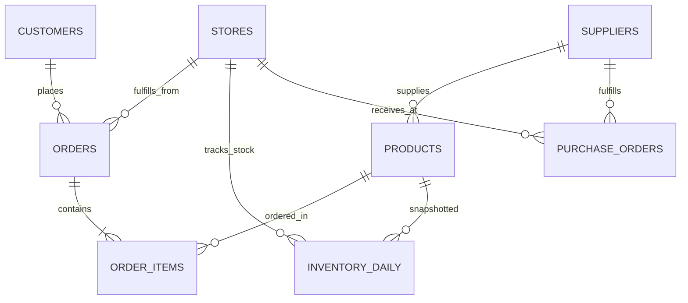

# 📘 Lembar Kerja & Panduan Belajar: Python Synthetic Retail Data Generator (V2 Hyper-Realistic)

> **Author:** Fajar Setyadi  
> **Role:** Data Analyst & Business Intelligence  
> **Target Project:** Omnichannel Retail & Supply Chain Performance Engine (PostgreSQL Enterprise)  
> **Lokasi File:** [`scripts/generate_synthetic_retail_data.py`](file:///d:/BOOTCAMP%20BUSSINESS%20INTELEGENCE%20&%20DATA%20ANALYST/project/Portfolio%20Project%202%20SQL/Omnichannel-Retail-Supply-Chain-Analytics-Engine/scripts/generate_synthetic_retail_data.py)  

---

## 🎯 Mengapa Harus Dataset "Hyper-Realistic" (Bukan Data Bot/Generik)?
Banyak portfolio data analyst pemula ditolak oleh Recruiter atau Data Lead karena datanya terlihat jelas dibuat oleh bot sederhana (contoh: pola nama kaku hanya 2 kata, nama yang sama berulang belasan kali, email fiktif berurutan, tidak ada nomor kontak, dan tidak ada konteks geografi lokal).

Pada generator versi 2 ini, kita menerapkan standar **Enterprise CRM & ERP Data Architecture**:
1. **Heterogenitas Demografi Jabodetabek:**
   * Nama 1 kata (12%): Tradisi Jawa/Sunda klasik (*Bambang, Suryanto, Sri, Retno, Asep, Imas*).
   * Nama 2 kata (48%): Kombinasi etnis wajar (*Kevin Wibowo, Salma Harahap, Dian Chandra*).
   * Nama 3 kata (40%): Pola nama generasi milenial/Gen-Z Jabodetabek (*Nicholas Putra Kusnadi, Michelle Wulandari Wijaya, Maruli Saputra Simanjuntak*).
2. **Kesesuaian Semantik Gender:**
   * Memisahkan nama belakang pria (*Saputra, Pratama*) dan wanita (*Saputri, Rahayu, Lestari, Handayani*).
3. **Data Profil Lengkap (Production-Ready CRM):**
   * Alamat email unik dengan kombinasi slug nama dan domain populer (`gmail.com`, `yahoo.co.id`, `outlook.com`, `icloud.com`, dll).
   * Nomor telepon seluler berformat operator GSM Indonesia (`0812`, `0813`, `0857`, `0878`, dll).
   * Domisili granular hingga tingkat **Kecamatan (District)** di Jabodetabek (Kebayoran Baru, Serpong, Menteng, Kelapa Gading, Cinere, dll).
4. **Kurva Diurnal Transaksi Alami (Human Shopping Behavior):**
   * Transaksi tidak disebar rata 24 jam secara acak, melainkan mengikuti kebiasaan manusia: lonjakan makan siang (*lunch rush 11:00 - 13:00*) dan lonjakan malam pulang kerja (*evening rush 18:00 - 21:00*).

---

## 🏗️ Struktur Relasional Dataset (3NF)



Dataset dibagi menjadi dua layer:
- **Layer 1: Master Seed Data (`data/seed/`)**
- **Layer 2: Operational & Transactional Raw Data (`data/raw/`)**

---

## 📂 Rincian File Dataset & Kasus Bisnisnya

### 1. `data/seed/seed_stores.csv` (12 Hub / Toko Fisik)
* **Konteks:** Memetakan 12 lokasi strategis Jabodetabek lengkap dengan alamat jalan riil, PIC Store Manager, nomor telepon kantor, dan kapasitas gudang (sqm).

### 2. `data/seed/seed_suppliers.csv` (15 Vendor FMCG Utama)
* **Konteks:** Vendor prinsipal (Indofood, Unilever, Mayora, Wings, Danone, Ultrajaya, Nestlé, dll).
* **Kontrak SLA:** Memuat komitmen *lead time* (2-4 hari), target SLA (94-98%), dan tarif denda penalti harian (1.5% - 3.0%). Dilengkapi nama PIC Account Manager dan email B2B.

### 3. `data/seed/seed_products.csv` (60 SKU Produk FMCG)
* **Konteks:** 60 produk unggulan lintas 6 kategori (*Packaged Food, Beverages, Dairy, Personal Care, Home Care, Fresh Produce*).
* **Variabel Analisis:** HPP (`cost_price`), harga jual ritel (`selling_price`), kecepatan perputaran (*velocity_tier*), dan batas pemesanan aman (*min_reorder_point*).

### 4. `data/seed/seed_customers.csv` (10.000 Pelanggan Jabodetabek)
* **Konteks:** Basis profil pelanggan realistis untuk analisis kohor (*Cohort Retention Matrix*) dan LTV (*Customer Lifetime Value*). 100% email unik dan nomor ponsel GSM terverifikasi.

### 5. `data/raw/raw_orders.csv` & `raw_order_items.csv` (100.000 Transaksi / 227k+ Items)
* **Kanal Omnichannel:** Mobile App, Website, In-Store POS, dan Quick Commerce Instant.
* **Waktu Alami:** Pola belanja mengikuti jam sibuk makan siang, malam hari, tanggal gajian (25-30), dan promo kembar (9.9, 10.10, 11.11, 12.12).

### 6. `data/raw/raw_inventory_daily.csv` (263.520 Snapshot Stok Harian - Full Year 2024 100% Tersinkronisasi)
* **Kasus Bisnis:** Snapshot harian 366 hari penuh tahun 2024 (1 Januari - 31 Desember) di 12 hub untuk seluruh 60 SKU produk FMCG (366 x 12 x 60 = 263.520 baris).
* **Injeksi Anomali "Ghost Stockout" & Rekonsiliasi 100%:** Kondisi di mana sistem mencatat stok barang masih tersedia (misal: 45 unit), namun di rak fisik hilang/rusak sehingga penjualan kasir (POS/Orders) menjadi 0 selama beberapa hari. Kolom `units_sold_today` 100% identik dengan jumlah kuantitas riil di `raw_order_items` tanpa celah kontradiksi. Disediakan flag `is_ghost_stockout` sebagai ground truth pembuktian query deteksi SQL.

### 7. `data/raw/raw_purchase_orders.csv` (8.000 PO Vendor)
* **Kasus Bisnis:** Transaksi pemesanan pasokan barang dengan format resi korporat (`PO-V001-20241206-0005`).
* **Kalkulasi Penalti:** Menghitung hari keterlambatan dan nominal denda penalti secara otomatis jika vendor melanggar SLA.

---

## 💻 Cara Menjalankan Script Generator

Buka terminal pada direktori proyek, lalu jalankan:

```bash
python scripts/generate_synthetic_retail_data.py
```

### Eksekusi Berkecepatan Tinggi (< 8 Detik):
Script telah dioptimalkan secara algoritmis:
* Menghilangkan *while loop* collision berulang pada email dengan teknik penomoran *deterministic sequence tag*.
* Mengganti perulangan sampling produk lambat dengan *batch unique sampling* berbasis bobot probabilitas.
* Output langsung di-*flush* ke console tanpa *buffering delay*.
