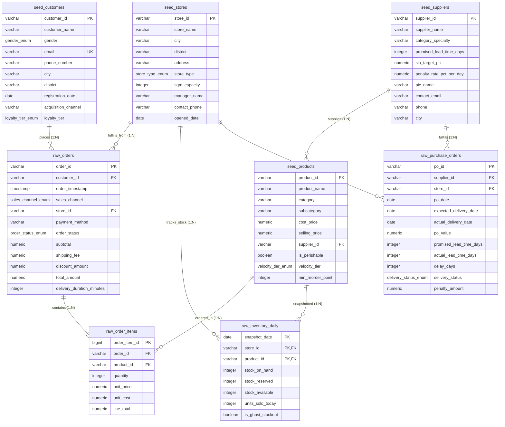

# 🏗️ Module 01: Relational Schema Architecture & DDL (3NF)
## Omnichannel Retail & Supply Chain Performance Engine

**Author:** Fajar Setyadi  
**Role:** Data Analyst & Business Intelligence  
**Target Environment:** PostgreSQL 15+ Enterprise  

---

## 🎯 Gambaran Modul
Modul ini bertanggung jawab membangun pondasi arsitektur database relasional **Third Normal Form (3NF)** yang kokoh, konsisten, dan mematuhi standar integritas data level enterprise. 

Arsitektur database dibagi menjadi dua layer utama:
1. **Master Seed Layer:** Menyimpan data referensi entitas inti ritel (cabang toko/hub, vendor FMCG, katalog produk, dan profil pelanggan).
2. **Transactional & Operational Raw Layer:** Menyimpan data lalu lintas transaksi pesanan, rincian keranjang belanja, pergerakan inventori harian, serta kontrak pengadaan barang vendor (*Purchase Orders*).

---

## 📐 Entity Relationship Diagram (ERD)



---

## 📂 Struktur File Script SQL

| File Script | Peran & Tanggung Jawab |
| :--- | :--- |
| [`00_run_all_ddl.sql`](file:///d:/BOOTCAMP%20BUSSINESS%20INTELEGENCE%20&%20DATA%20ANALYST/project/Portfolio%20Project%202%20SQL/Omnichannel-Retail-Supply-Chain-Analytics-Engine/sql/01_schema_ddl/00_run_all_ddl.sql) | Master orchestrator psql untuk menjalankan seluruh DDL secara otomatis. |
| [`01_create_enums_and_domains.sql`](file:///d:/BOOTCAMP%20BUSSINESS%20INTELEGENCE%20&%20DATA%20ANALYST/project/Portfolio%20Project%202%20SQL/Omnichannel-Retail-Supply-Chain-Analytics-Engine/sql/01_schema_ddl/01_create_enums_and_domains.sql) | Definisi tipe data kustom ENUM (`order_status`, `sales_channel`, `delivery_status`, dll). |
| [`02_create_tables.sql`](file:///d:/BOOTCAMP%20BUSSINESS%20INTELEGENCE%20&%20DATA%20ANALYST/project/Portfolio%20Project%202%20SQL/Omnichannel-Retail-Supply-Chain-Analytics-Engine/sql/01_schema_ddl/02_create_tables.sql) | DDL 8 tabel relasional 3NF beserta Primary Key & Foreign Key. |
| [`03_add_constraints.sql`](file:///d:/BOOTCAMP%20BUSSINESS%20INTELEGENCE%20&%20DATA%20ANALYST/project/Portfolio%20Project%202%20SQL/Omnichannel-Retail-Supply-Chain-Analytics-Engine/sql/01_schema_ddl/03_add_constraints.sql) | Business Integrity CHECK Constraints (validasi harga, stok gudang, kalkulasi total). |
| [`04_verify_schema.sql`](file:///d:/BOOTCAMP%20BUSSINESS%20INTELEGENCE%20&%20DATA%20ANALYST/project/Portfolio%20Project%202%20SQL/Omnichannel-Retail-Supply-Chain-Analytics-Engine/sql/01_schema_ddl/04_verify_schema.sql) | Script diagnostik untuk mengaudit keberadaan tabel, constraints, dan tipe kolom. |

---

## 💻 Panduan Eksekusi

### Opsi A: Menggunakan PostgreSQL CLI (`psql`)
Buka terminal dan jalankan:
```bash
psql -U postgres -d omnichannel_retail_db -f sql/01_schema_ddl/00_run_all_ddl.sql
```

### Opsi B: Menggunakan GUI Client (DBeaver / pgAdmin / DataGrip)
Buka file secara berurutan dan jalankan:
1. `01_create_enums_and_domains.sql`
2. `02_create_tables.sql`
3. `03_add_constraints.sql`
4. `04_verify_schema.sql` (Verifikasi hasil)
