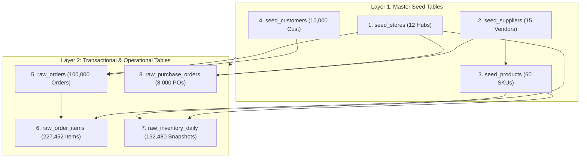

# 📥 Module 02: High-Performance Bulk Data Ingestion & Quality Reconciliation
## Omnichannel Retail & Supply Chain Performance Engine

**Author:** Fajar Setyadi  
**Role:** Data Analyst & Business Intelligence  
**Target Environment:** PostgreSQL 15+ Enterprise  

---

## 🎯 Gambaran Modul
Modul ini bertanggung jawab memuat seluruh dataset transaksi dan inventori skala besar (480.000+ baris data) dari format file CSV ke dalam skema tabel PostgreSQL 3NF secara cepat, aman, dan mematuhi aturan Foreign Key.

Selain proses pemuatan, modul ini menyertakan **Enterprise Data Quality & Reconciliation Suite** untuk mengaudit bahwa data yang landed di database tidak mengalami kebocoran baris, tidak memiliki record yatim (*orphan records*), dan 100% konsisten antara transaksi kasir dengan catatan buku stok gudang.

---

## ⛓️ Urutan Pemuatan Dependensi (Dependency Loading Chain)

Pemuatan data wajib mengikuti hierarki relasional agar tidak melanggar *Foreign Key Constraints*:



---

## 📂 Struktur File Script SQL

| File Script | Peran & Tanggung Jawab |
| :--- | :--- |
| [`00_run_ingestion.sql`](file:///d:/BOOTCAMP%20BUSSINESS%20INTELEGENCE%20&%20DATA%20ANALYST/project/Portfolio%20Project%202%20SQL/Omnichannel-Retail-Supply-Chain-Analytics-Engine/sql/02_data_ingestion/00_run_ingestion.sql) | Master runner psql untuk mengeksekusi pemuatan dan rangkaian pengujian secara otomatis. |
| [`01_copy_from_csv.sql`](file:///d:/BOOTCAMP%20BUSSINESS%20INTELEGENCE%20&%20DATA%20ANALYST/project/Portfolio%20Project%202%20SQL/Omnichannel-Retail-Supply-Chain-Analytics-Engine/sql/02_data_ingestion/01_copy_from_csv.sql) | Script bulk loading menggunakan perintah `\copy` berbasis client-side yang cepat & aman. |
| [`02_validate_ingestion.sql`](file:///d:/BOOTCAMP%20BUSSINESS%20INTELEGENCE%20&%20DATA%20ANALYST/project/Portfolio%20Project%202%20SQL/Omnichannel-Retail-Supply-Chain-Analytics-Engine/sql/02_data_ingestion/02_validate_ingestion.sql) | Suite pengujian kualitas data: row count match, orphan detection, Ghost Stockout reconciliation, & storage size audit. |

---

## 📊 Matriks Target Rekonsiliasi Jumlah Baris

| Nama Tabel | Target Baris CSV | Tipe Entitas | Target Status Rekonsiliasi |
| :--- | :---: | :--- | :---: |
| `seed_stores` | **12** | Master Cabang Toko | `✅ 100% MATCH` |
| `seed_suppliers` | **15** | Master Vendor FMCG | `✅ 100% MATCH` |
| `seed_products` | **60** | Master Katalog SKU | `✅ 100% MATCH` |
| `seed_customers` | **10.000** | Master Pelanggan | `✅ 100% MATCH` |
| `raw_orders` | **100.000** | Header Transaksi | `✅ 100% MATCH` |
| `raw_order_items` | **228.177** | Detail Keranjang Belanja | `✅ 100% MATCH` |
| `raw_inventory_daily` | **263.520** | Snapshot Stok Harian (Full Year 366 Hari) | `✅ 100% MATCH` |
| `raw_purchase_orders` | **8.000** | Kontrak Pemesanan Vendor | `✅ 100% MATCH` |
| **TOTAL** | **609.769** | **Baris Data Bersih** | **Zero Data Loss** |

---

## 💻 Panduan Eksekusi

### Opsi A: Menggunakan PostgreSQL CLI (`psql`)
Jalankan dari direktori utama proyek:
```bash
psql -U postgres -d omnichannel_retail_db -f sql/02_data_ingestion/00_run_ingestion.sql
```

### Opsi B: Menggunakan GUI Client (DBeaver / pgAdmin / DataGrip)
1. Jalankan `01_copy_from_csv.sql` (atau gunakan fitur *Import Data from CSV* bawaan GUI).
2. Jalankan `02_validate_ingestion.sql` untuk mengaudit seluruh hasil pemuatan data.
