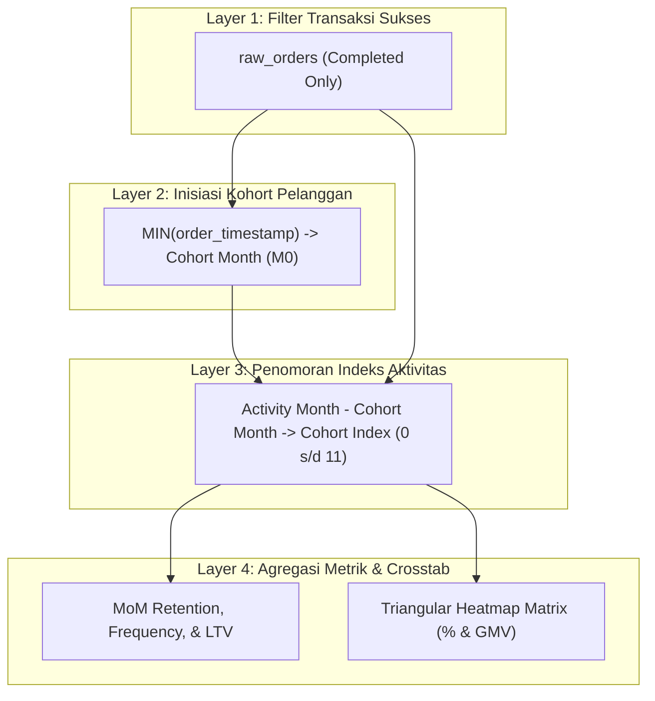

# 👥 Module 04: Customer Lifecycle & Cohort Retention Analysis
## Omnichannel Retail & Supply Chain Performance Engine

**Author:** Fajar Setyadi  
**Role:** Data Analyst & Business Intelligence  
**Target Environment:** PostgreSQL 15+ Enterprise  

---

## 🎯 Gambaran Modul

Mengakuisisi pelanggan baru (*Customer Acquisition Cost / CAC*) di industri ritel modern memerlukan biaya modal pemasaran yang sangat tinggi. Pertumbuhan bisnis yang berkelanjutan (*sustainable profitability*) tidak bertumpu pada akuisisi satu kali (*one-off buyers*), melainkan pada kemampuan mempertahankan pelanggan agar bertransaksi kembali secara berulang (*repeat purchase retention*).

Modul ini membedah siklus hidup pelanggan (*Customer Lifecycle*) menggunakan **analisis kohort retensi (*Cohort Retention Analysis*) tingkat lanjut berbasis SQL murni** tanpa bergantung pada alat visualisasi eksternal (Python/Pandas/Excel).

Modul ini menjawab pertanyaan-pertanyaan strategis Manajemen (CMO, VP of Growth, CEO):
1. **Dinamika Akuisisi**: Berapa banyak pelanggan baru yang berhasil diakuisisi setiap bulannya dan kanal belanja mana yang menjadi pintu gerbang utama (*First-Touch Channel Attribution*)?
2. **Kesehatan Retensi (MoM Retention Rate)**: Berapa persen pelanggan dari masing-masing gelombang kohort yang masih aktif bertransaksi di bulan $M_1, M_2, \dots, M_{11}$?
3. **Laju Churn (Churn Velocity)**: Pada titik bulan ke berapa penurunan terbesar (*retention drop-off*) terjadi?
4. **Pertumbuhan Nilai Seumur Hidup (Customer Lifetime Value / LTV)**: Berapa akumulasi rupiah GMV rata-rata yang disumbangkan oleh seorang pelanggan seiring berjalannya waktu?
5. **Matriks Segitiga Panas (Triangular Heatmap Pivot)**: Bagaimana menyajikan matriks retensi tabular secara elegan langsung dari database engine?

---

## ⛓️ Alur Arsitektur Logika SQL



---

## 📂 Struktur File Script SQL

| File Script | Peran & Tanggung Jawab Analitik |
| :--- | :--- |
| [`00_run_cohort_analysis.sql`](file:///d:/BOOTCAMP%20BUSSINESS%20INTELEGENCE%20&%20DATA%20ANALYST/project/Portfolio%20Project%202%20SQL/Omnichannel-Retail-Supply-Chain-Analytics-Engine/sql/04_cohort_retention/00_run_cohort_analysis.sql) | Master runner psql untuk mengeksekusi seluruh rangkaian analisis kohort retensi secara berurutan. |
| [`01_cohort_first_purchase.sql`](file:///d:/BOOTCAMP%20BUSSINESS%20INTELEGENCE%20&%20DATA%20ANALYST/project/Portfolio%20Project%202%20SQL/Omnichannel-Retail-Supply-Chain-Analytics-Engine/sql/04_cohort_retention/01_cohort_first_purchase.sql) | Menentukan tanggal transaksi pertama tiap pelanggan, ukuran awal kohort, atribusi kanal pertama (*first-touch*), dan profil segmentasi loyalitas. |
| [`02_mom_retention_matrix.sql`](file:///d:/BOOTCAMP%20BUSSINESS%20INTELEGENCE%20&%20DATA%20ANALYST/project/Portfolio%20Project%202%20SQL/Omnichannel-Retail-Supply-Chain-Analytics-Engine/sql/04_cohort_retention/02_mom_retention_matrix.sql) | Rincian vertikal retensi Month-over-Month ($M_0$ s/d $M_{11}$), frekuensi order per pelanggan aktif, analisis titik henti churn (*drop-off*), dan akumulasi LTV. |
| [`03_cohort_crosstab_pivot.sql`](file:///d:/BOOTCAMP%20BUSSINESS%20INTELEGENCE%20&%20DATA%20ANALYST/project/Portfolio%20Project%202%20SQL/Omnichannel-Retail-Supply-Chain-Analytics-Engine/sql/04_cohort_retention/03_cohort_crosstab_pivot.sql) | Pivot matriks segitiga retensi (*Triangular Heatmap Matrix*) via *ANSI SQL conditional aggregation* untuk persentase retensi, jumlah pelanggan aktif, dan omzet repeat GMV. |

---

## 🔬 Metodologi & Formulasi Matematis SQL

### 1. Penentuan Bulan Kohort Akuisisi Pertama (*Cohort Inception Month*)
Bulan kohort didefinisikan sebagai tanggal awal bulan dari pesanan berstatus `COMPLETED` pertama kali milik seorang pelanggan:
$$\text{Cohort Month}_c = \text{DATE\_TRUNC}('month', \min(t_{\text{order}, c}))$$

### 2. Penghitungan Indeks Bulan Aktivitas (*Cohort Month Index $N$*)
Indeks bulan mengukur jarak temporal antara bulan transaksi berjalan dengan bulan akuisisi awal:
$$\text{Cohort Index} = (\text{Year}_{\text{activity}} - \text{Year}_{\text{cohort}}) \times 12 + (\text{Month}_{\text{activity}} - \text{Month}_{\text{cohort}})$$
* $M_0$: Bulan pertama kali pelanggan berbelanja (Index = 0, Retensi = 100%).
* $M_1$: Bulan berikutnya setelah akuisisi (Index = 1).
* $M_{11}$: Bulan kesebelas setelah akuisisi (Index = 11).

### 3. Tingkat Retensi & Churn (*Retention & Churn Rates*)
$$\text{Retention Rate \%}_{c, k} = \frac{\text{Unique Active Customers in } M_k}{\text{Initial Cohort Size in } M_0} \times 100$$
$$\text{Churn Rate \%}_{c, k} = 100\% - \text{Retention Rate \%}_{c, k}$$

### 4. Akumulasi Customer Lifetime Value (Cumulative LTV Trajectory)
$$\text{Cumulative LTV}_{c, k} = \frac{\sum_{i=0}^{k} \text{Total GMV Spend}_{c, i}}{\text{Initial Cohort Size in } M_0}$$

### 5. Pivot Matriks Segitiga (*Triangular Crosstab Conditional Aggregation*)
Tanpa memerlukan modul eksternal PostgreSQL seperti `tablefunc` (`crosstab()`), kueri menggunakan standar murni ANSI SQL yang portabel di seluruh database enterprise:
```sql
SELECT 
    cohort_month,
    cohort_size,
    ROUND(MAX(CASE WHEN cohort_index = 0 THEN active_customers END) * 100.0 / cohort_size, 1) AS m0_pct,
    ROUND(MAX(CASE WHEN cohort_index = 1 THEN active_customers END) * 100.0 / cohort_size, 1) AS m1_pct,
    ...
    ROUND(MAX(CASE WHEN cohort_index = 11 THEN active_customers END) * 100.0 / cohort_size, 1) AS m11_pct
FROM cohort_activity_counts
GROUP BY cohort_month, cohort_size
ORDER BY cohort_month;
```

---

## 📈 Rangkuman Temuan Empiris (Hasil Eksekusi Dataset Riil 2024)

Berdasarkan pengujian terhadap **8.930 pelanggan unik yang bertransaksi** di sepanjang 366 hari tahun 2024:

### 1. Dinamika Akuisisi Pelanggan
* **Total Basis Pelanggan Aktif:** 8.930 pelanggan unik berhasil diakuisisi dan menyelesaikan pesanan.
* **Gelombang Akuisisi Terbesar:** Kohort **Januari 2024** mendominasi dengan **1.155 pelanggan (12,93% dari total basis)**, disusul oleh Mei (821 pelanggan) dan April (800 pelanggan).
* **Kanal Pintu Gerbang Terbesar:** **Mobile App** menjadi kontributor akuisisi pertama terbesar (> 50% transaksi pertama dilakukan lewat aplikasi mobile), membuktikan efektivitas kampanye instalasi aplikasi.

### 2. Matriks Segitiga Retensi Pelanggan (Triangular Retention Matrix)

Berikut adalah representasi matriks retensi aktual yang dihasilkan oleh kueri `03_cohort_crosstab_pivot.sql`:

| Cohort Month | Size | M0 | M1 | M2 | M3 | M4 | M5 | M6 | M7 | M8 | M9 | M10 | M11 |
| :---: | :---: | :---: | :---: | :---: | :---: | :---: | :---: | :---: | :---: | :---: | :---: | :---: | :---: |
| **2024-01** | 1,155 | 100% | **55.9%** | 58.4% | 58.4% | 59.9% | 58.7% | 60.2% | 58.4% | 58.3% | 59.1% | 57.7% | **60.3%** |
| **2024-02** | 763 | 100% | **46.5%** | 47.6% | 45.0% | 46.7% | 46.3% | 49.1% | 49.7% | 45.5% | 49.7% | 48.1% | - |
| **2024-03** | 777 | 100% | **41.6%** | 42.0% | 41.8% | 44.5% | 43.0% | 41.2% | 39.0% | 43.9% | 42.2% | - | - |
| **2024-04** | 800 | 100% | **43.8%** | 41.1% | 40.8% | 41.8% | 44.4% | 41.1% | 42.9% | 40.1% | - | - | - |
| **2024-05** | 821 | 100% | **40.0%** | 40.7% | 39.0% | 41.8% | 38.9% | 40.4% | 39.0% | - | - | - | - |
| **2024-06** | 765 | 100% | **43.4%** | 42.9% | 39.2% | 40.3% | 41.0% | 39.6% | - | - | - | - | - |
| **2024-07** | 729 | 100% | **41.3%** | 40.6% | 40.9% | 38.5% | 40.3% | - | - | - | - | - | - |
| **2024-08** | 731 | 100% | **39.5%** | 40.5% | 38.4% | 36.8% | - | - | - | - | - | - | - |
| **2024-09** | 746 | 100% | **38.9%** | 35.8% | 38.7% | - | - | - | - | - | - | - | - |
| **2024-10** | 748 | 100% | **38.9%** | 35.6% | - | - | - | - | - | - | - | - | - |
| **2024-11** | 763 | 100% | **39.8%** | - | - | - | - | - | - | - | - | - | - |
| **2024-12** | 132 | 100% | - | - | - | - | - | - | - | - | - | - | - |

### 3. Wawasan Bisnis Strategis (Strategic Insights)
* **Pola Kurva Retensi Ritel Sehat (*Hockey-Stick Curve*)**:  
  Penurunan terbesar (*churn drop-off*) terjadi di transisi $M_0 \rightarrow M_1$ (sebesar 44% – 60% pelanggan tidak kembali di bulan kedua). Namun, bagi pelanggan yang bertahan di $M_1$, kurva retensi langsung **mendatar dan stabil** di rentang **38% – 60%** hingga bulan ke-11! Ini menandakan produk dan layanan memiliki *product-market fit* yang sangat kuat bagi pengguna inti (*core recurring buyers*).
* **Superioritas Kohort Januari 2024**:  
  Kohort Januari mempertahankan tingkat retensi tertinggi di seluruh periode (~58% – 60%), membuktikan bahwa promosi awal tahun berhasil menjaring basis pelanggan berkualitas tinggi (*high loyalty affinity*).
* **Pertumbuhan LTV Seumur Hidup**:  
  Untuk kohort Januari 2024, nilai belanja rata-rata per pelanggan terakuisisi melonjak dari **Rp 184.673** pada $M_0$ menjadi lebih dari **Rp 1.580.000** pada $M_{11}$ (tumbuh 8,5x lipat), membuktikan bahwa basis pelanggan aktif menghasilkan margin laba yang semakin besar dari waktu ke waktu.

---

## 🚀 Panduan Menjalankan Script

Jalankan master runner via psql terminal:

```bash
# Jalankan seluruh Phase 4 secara otomatis
psql -U postgres -d omnichannel_retail_db -f sql/04_cohort_retention/00_run_cohort_analysis.sql
```

Atau jalankan kueri individual untuk analisis interaktif:
```bash
psql -U postgres -d omnichannel_retail_db -f sql/04_cohort_retention/01_cohort_first_purchase.sql
psql -U postgres -d omnichannel_retail_db -f sql/04_cohort_retention/02_mom_retention_matrix.sql
psql -U postgres -d omnichannel_retail_db -f sql/04_cohort_retention/03_cohort_crosstab_pivot.sql
```
